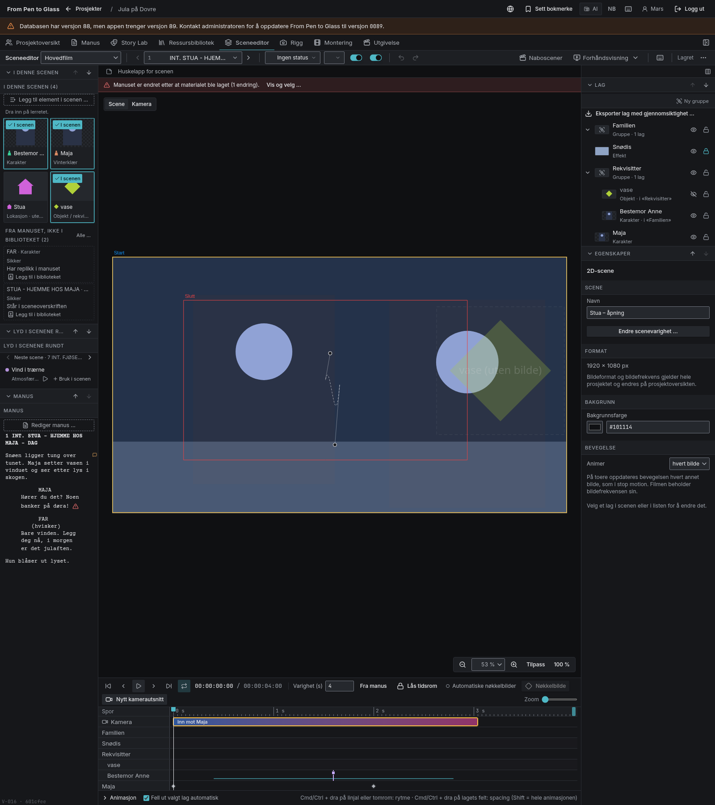
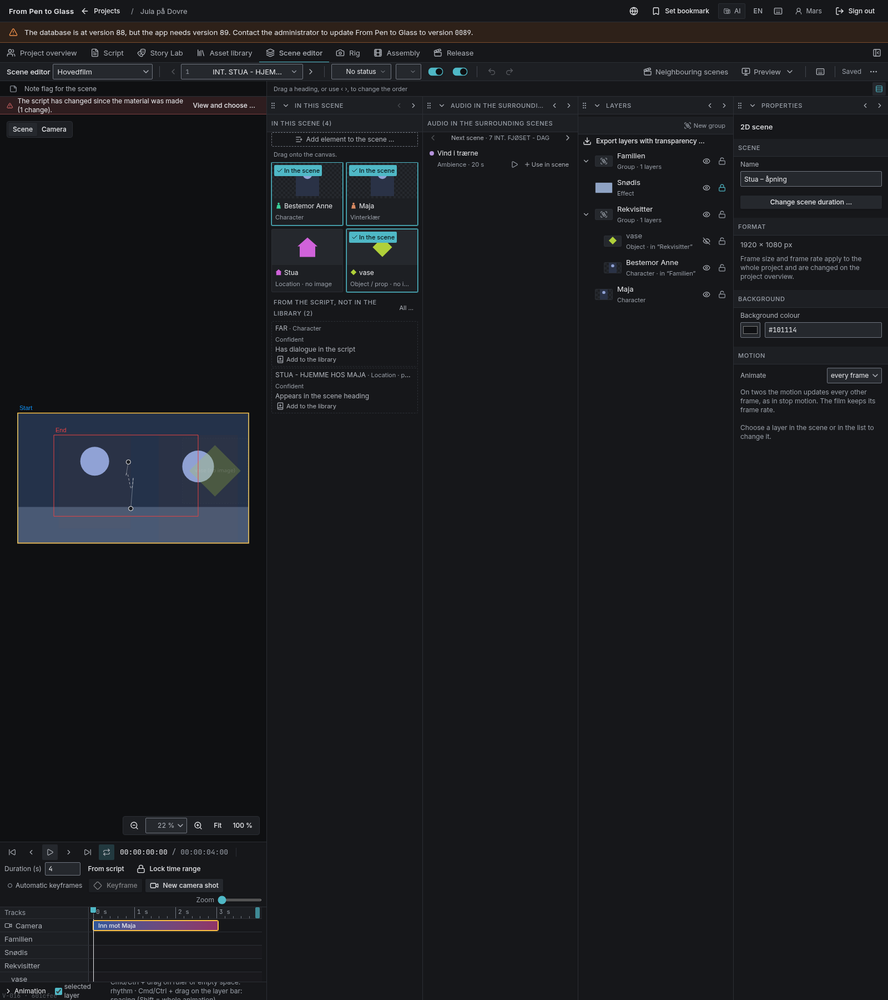
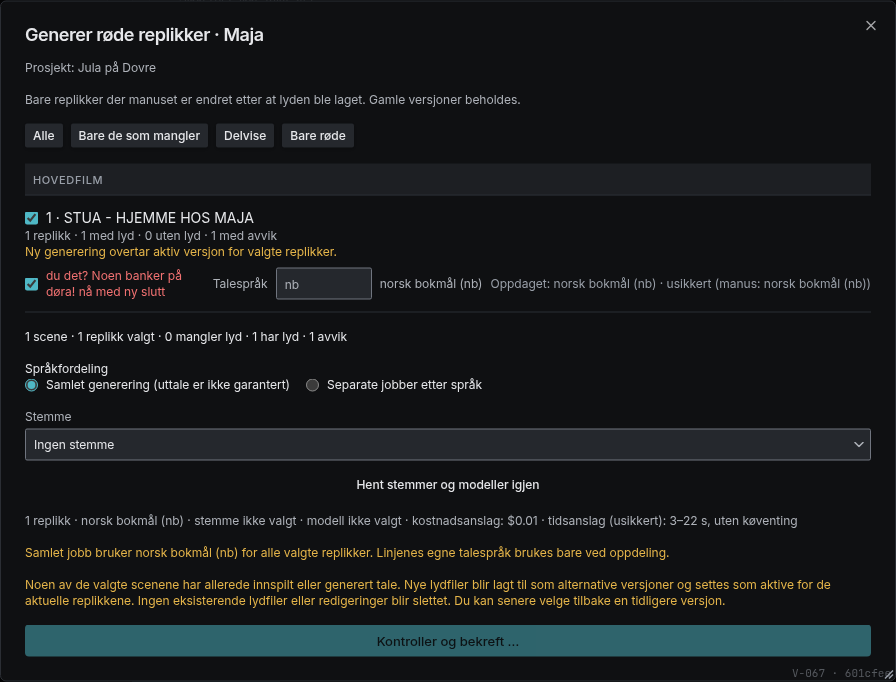
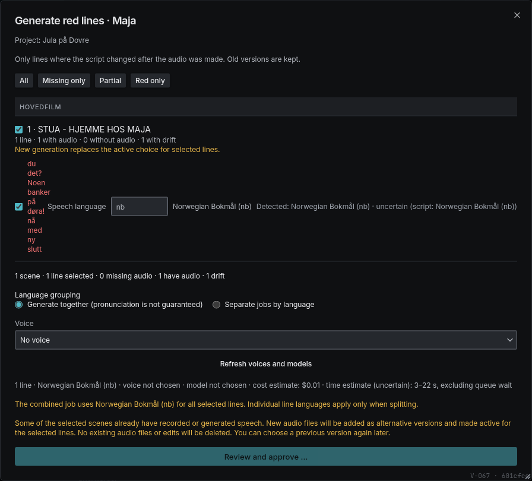

# N11 – teknisk gjeld, 23.10.2026

**Status: delvis levert.** Punkt 1 og 4 er rettet og kontrollert. Punkt 3 har en målt, moderat forbedring. Punkt 2 har ni nye verifikasjoner, men 17 krav står fortsatt åpne. Ingen migrasjon, Cloud-endringer, betalte AI-kall eller publisering.

Arbeidsmetode: **animatic-testing**. Eksisterende arkitekturtester og forventninger er ikke svekket; de ti eksisterende hoppede testene er ikke endret. Alle tjenester i nettlesertestene er mocket. Ingen pakker er installert eller fjernet.

## 1. scene-panels-ui

Årsaken til de gamle 13/12-feilene var at suiten kunne starte med engelsk grensesnitt, mens forventningene var norske. Profil, informasjonskapsel, personlig lokalt språkvalg og nettleserspråk settes nå eksplisitt fra `UI_LANG`. Første side venter på full lasting før neste navigasjon, slik at innloggingssidens pågående navigasjon ikke avbryter scenen.

De samme kontrollene kjøres på begge språk. Engelske forventninger bruker appens faktiske «Show the panels stacked» og «Placement», ikke de tidligere gjettede oversettelsene. Ingen panelkode eller språkinnhold er endret.

- `UI_LANG=nb ... scene-panels-ui.mjs`: **39 bestått, 0 feilet**.
- `UI_LANG=en ... scene-panels-ui.mjs`: **39 bestått, 0 feilet**.
- Side-om-side, stablet oppsett, husket rekkefølge, smalt vindu og huskede grupper er kontrollert; ingen kjørefeil i suiten.

Skjermbildene bruker faste testdata. Skjemavarselet 88/89 er testfixturens metadata, ikke et funn fra Cloud. Ingen database er endret for å fjerne varselet.

## 2. Målrettede tester for N6-restkrav

Ni krav er flyttet til **Verifisert**, med navngitt bestått test i `requirements.yaml`:

| Krav | Test som sjekker akseptansen |
|---|---|
| REQ-0764 | `n11-scene-audio.test.tsx`: to karakterer får navngitte spor; to replikker deler riktig karakterspor. Nb/en, ekte gruppering. |
| REQ-0778 | `dv4-voice.mjs`: velger annen ElevenLabs-stemme, godkjenner mocket generering og leser tilbake `other_voice` og valgt språk i kommandoen. |
| REQ-0782 | `n11-dialogue-batch.test.tsx`: scene og enkeltreplikk kan velges bort; bare valgte permanente nøkler sendes etter godkjenning. Nb/en. |
| REQ-0790 | `dv5-dv6.test.ts`: ny generert fil knyttes til riktig permanent scene og replikk, riktig aktive lydversjon og fil; uvedkommende klipp er uendret og gjentaking er idempotent. |
| REQ-0798 | `n11-dialogue-batch.test.tsx`: samlet modus med advarsel og kostnadsport; ingen automatisk generering. Nb/en. |
| REQ-0800 | `n11-dialogue-batch.test.tsx`: valgt innhold fordeles til separate språkjobber med beregnet pris per jobb; bare valgte nøkler sendes til sitt språk. `no` normaliseres til `nb`. Nb/en. |
| REQ-0813 | `dv7-drift.mjs`: avvikshandlingen åpnes fra den aktuelle karakterens bibliotekside. Nb/en. |
| REQ-0815 | `dv7-drift.mjs`: én rød replikk velges bort uten å endre andre valg. Nb/en. |
| REQ-0816 | `dv7-drift.mjs`: konkret dollarkostnad og språkkode vises i avvikslisten før generering; ingen jobb starter ved inspeksjon. Nb/en. |

`dv4-voice`: **24/0**. Utvidet `dv7-drift`: **38/0**. Nye batch- og karakterspor-tester: **8/0**. Tjenestekall er faste mocks; verifikasjonene er ikke påstander om ekte leverandøruttale eller en Cloud-rundtur.

### Fortsatt ikke Verifisert

Disse står fortsatt med uverifisert status. N11-punkt 2 er **ikke ferdig**. Det er ikke lagt til funksjoner for å skjule manglende testdekning.

| Krav | Konkret gjenstående kontroll / begrensning |
|---|---|
| REQ-0757 | Opptaksvindu med faktisk bilde på valgt karakter; N6-fixturen mangler omslagsbilde. |
| REQ-0760 | Opptak og samtidig sceneavspilling fra riktig avspillingshode. Krever deterministisk mikrofon-/avspillingsharness, ikke ekte mikrofon. |
| REQ-0762 | Lydprofilens kurver, hastighet og bølgeform gjennom faktiske kontroller, ikke bare kjernelogikk. |
| REQ-0781 | Egen fixture med både helt og delvis manglende tale, og kontroll av vist dekning. |
| REQ-0783 | Ordrett bekreftet advarsel sammenlignet med spesifikasjonen; nå testes synlighet, ikke ordrett mandattekst. |
| REQ-0805 | Brukerklikk på avvikshandlingen helt frem til riktig scene/replikk. Den eksisterende suiten navigerer direkte. |
| REQ-0806 | Les tilbake faktisk avspillingshode etter slik navigasjon. Ingen autoavspilling er allerede testet, men det er ikke nok. |
| REQ-0121 | Opprette og vise alle de elleve ressurskategoriene, ikke bare den eksisterende delmengden. |
| REQ-0143 | Publisert harmonisert global variant og bevaring av tidligere materiale. |
| REQ-0401 | Brukerens konkrete kvalitet-/modellvalg helt frem til harmoniseringsmotorens mocket forespørsel. |
| REQ-0402 | Harmonisering og global publisering i samme kontroll, med bevarte versjoner. |
| REQ-0571 | Avklaring av «ikke kopiering» mot eksisterende autorisert filkopiering. Ingen produktvalg er tatt. |
| REQ-0699 | Tjenestevalget huskes og gjenbrukes, med kostnadsgodkjenning i den konkrete opptaksflyten. |
| REQ-0704 | Bare ny tekst tas opp, med riktig plassering; eksisterende lyd og redigering leses tilbake uendret. |
| REQ-0708 | Hele akseptansen for virkelig/uegnet romlyd og pauser, utover de eksisterende syntetiske kjernetestene. |
| REQ-0709 | Forhåndslytting av endrede overganger; kjernetesten for å legge til/endre/fjerne er ikke nok. |
| REQ-0839 | Faktisk VP9-alfa-koding og dekoding som bekrefter gjennomsiktige piksler. Negativ støtte-/avbruddstest er grønn, men ikke full kodeverifikasjon. |

REQ-0839 har fått sterkere negative tester: manglende encoder og en probe som avviser/kaster gir aldri positiv støtte; eksport uten støtte avbryter sinken uten å skrive/lukke en svart reservefil. Kravet er **ikke** oppgradert på dette grunnlaget alene.

## 3. Vitest-hastighet

Store importkilder:
- `src/core/i18n/runtime.gen.json`: **2 805 787 byte**, importeres av nøkkeloversetteren og dermed mange `@/core`-tester.
- Full nb-/en-katalog: **2 597 717 / 2 615 577 byte**. De trengs av katalog-/inventartestene; de er ikke erstattet med ufullstendige mocks.
- `src/core/commands/apply.ts`: **353 264 byte**; bredt brukt via kjernens samleimport.
- Inventartestene scanner kilder og store genererte oversikter; `candidates.v1.json` er **9 308 022 byte**.

35 rene testfiler bruker nå `@vitest-environment node` i stedet for jsdom. Alle forventninger, nettverkssperren, oppsettet og arkitekturtestene er beholdt. Ingen endring av produksjonens språklasting eller brukerisolasjon.

### Sammenlignbar full kjøring

Samme kode, samme testinnhold, samme globale konfigurasjon; bare de 35 miljømarkørene ble midlertidig fjernet i førkjøringen og deretter nøyaktig gjenopprettet.

| | Før (jsdom i de 35 filene) | Etter (node i de 35 filene) |
|---|---:|---:|
| Beståtte tester | 2708 | 2708 |
| Feilede tester | 0 | 0 |
| Eksisterende hoppet over | 10 | 10 |
| Total tid | **148,89 s** | **142,27 s** |

Gevinst: **6,62 s / 4,4 %**. Det er en moderat forbedring, ikke en dokumentert løsning på Claudes ni minutter. Tidlige kjøringer varierte fra rundt 104 til 164 sekunder; de kan ikke brukes som en stabil før/etter-sammenligning. Ingen parallell nettlesertest ble kjørt under det avsluttende måleparet.

Forsøk med JSON-stringify, threads og færre arbeidere ga ingen sikker forbedring og er ikke beholdt. Globale pool-/optimizer-innstillinger er uendret. De tyngste testtidene i sluttkjøringen ligger blant annet i ZIP64, tilfeldige kommandosekvenser og språk­inventar; disse er ikke svekket.

## 4. Asset Studio-utkast og plassholdere

`UpdateSceneDraft` er ikke lenger unntatt fra refit-passeringen i `applyCommand`. Tilpasningen beregnes fra utkastets **endelige tilstand**, ikke som et ekstra brukerredigert utkastfelt. Inversen er fortsatt `WithLayerRefit`, og hver rad får bare én revisjonsøkning.

`n11-draft-refit.test.ts`, **2/0**:
- En plassholder som får 1600 × 900-bilde blir 1600 × 900 med samme senter og vanlig innsettingsskala **0,6 i begge retninger**, én revisjon og ett angretrinn.
- Angre og gjør om leser tilbake riktig bilde/transform.
- En samtidig endring av uvedkommende lagnavn overlever rebase, lagring og angring.

Ingen migrasjon eller endring av utkastets feltvise konfliktmodell. AGENTS.md regel 57 presiserer at regelen også gjelder utkastlagring.

## Kontroller

- Full `bunx vitest run`: **2708 bestått, 0 feilet, 10 eksisterende hoppet over**, både før og etter måleparet.
- Automatisk typekontroll/build: **build OK**, senest etter endringene. Ingen manuell typekontroll eller byggkjøring, i tråd med miljøets regler.
- `node scripts/i18n/check.mjs`: **0 tekster uten engelsk i 0 filer**, komplett inventar-/språkkontroll grønn.
- `build_docs.py` og `check_kb.py`: **924 krav, 12 skills, 0 mandatlinjer uten kravreferanse, OK**.
- Genererte språkoversikter hadde utdaterte posisjonsreferanser etter refit-endringen. Bare `references.v1.json`, `candidates.v1.json` og `inventory-report.json` er regenerert; ingen språktekst/katalog er endret.
- PyYAML finnes ikke i dette miljøet. Dokumentkontrollen brukte den allerede tilgjengelige ruamel-leseren gjennom et midlertidig `safe_load`-kompatibilitetslag i `/tmp`; ingen repo-skript eller pakker ble endret for dette.
- JavaScript-Playwright finnes ikke som prosjektpakke. Visuelle suiter kjørte fra midlertidige kopier med import til den allerede tilgjengelige Python-Playwright-driverens JS-pakke. Prosjektets import er beholdt. Faste mockede økter, ingen ekte innloggings- eller Cloud-rundtur.
- Ingen separat DB-kjøring i N11; ingen databaseskjema eller lagringsadapter er endret. Ingen migrasjoner skrevet eller kjørt.
- Ingen publisering eller ekte/betalte AI-kall. Forbruket mot grensen på rundt 300 credits er **ikke separat målt**, så et bestemt forbruk påstås ikke.

## Nøyaktig filliste

Produksjon, tester og genererte oversikter:
- `AGENTS.md`
- `src/core/commands/apply.ts`
- `tests/visual/scene-panels-ui.mjs`
- `tests/visual/dv7-drift.mjs`
- `tests/unit/dv5-dv6.test.ts`
- `tests/unit/layer-alpha.test.ts`
- `tests/unit/n11-dialogue-batch.test.tsx`
- `tests/unit/n11-draft-refit.test.ts`
- `tests/unit/n11-scene-audio.test.tsx`
- `scripts/i18n/references.v1.json`
- `scripts/i18n/candidates.v1.json`
- `scripts/i18n/inventory-report.json`

Bare node-miljømarkør i disse 35 eksisterende testfilene:
- `tests/unit/account-admin.test.ts`
- `tests/unit/ai-effort.test.ts`
- `tests/unit/ai-trace.test.ts`
- `tests/unit/audio-composition.test.ts`
- `tests/unit/audio-pauses-script.test.ts`
- `tests/unit/audio-pauses.test.ts`
- `tests/unit/audio-performance.test.ts`
- `tests/unit/audio-takes.test.ts`
- `tests/unit/audio-transitions.test.ts`
- `tests/unit/b097-last-changed.test.ts`
- `tests/unit/b097-relative-time.test.ts`
- `tests/unit/b100-length.test.ts`
- `tests/unit/b104-product-name.test.ts`
- `tests/unit/b107-languages.test.ts`
- `tests/unit/b118-scene-marks.test.ts`
- `tests/unit/beyond-end.test.ts`
- `tests/unit/block-links.test.ts`
- `tests/unit/context-names.test.ts`
- `tests/unit/cost-breakdown.test.ts`
- `tests/unit/cost-report.test.ts`
- `tests/unit/coverage.test.ts`
- `tests/unit/dialogue-navigation.test.ts`
- `tests/unit/dialogue-versions.test.ts`
- `tests/unit/film-selection.test.ts`
- `tests/unit/karaktertekst.test.ts`
- `tests/unit/layer-fit.test.ts`
- `tests/unit/layer-groups.test.ts`
- `tests/unit/line-linking.test.ts`
- `tests/unit/model-prompt.test.ts`
- `tests/unit/part-transition.test.ts`
- `tests/unit/provider-capabilities.test.ts`
- `tests/unit/quality-profiles.test.ts`
- `tests/unit/quality.test.ts`
- `tests/unit/remove-translations.test.ts`
- `tests/unit/word-alignment.test.ts`

Dokumentasjon:
- `roadmap.md`
- `TODO.md`
- `docs/product/requirements.yaml`
- `docs/product/REQUIREMENTS.md`
- `docs/product/TRACEABILITY_MATRIX.md`
- `docs/development/CURRENT_WORK.md`
- `docs/development/SESSION_HANDOVER.md`
- `docs/development/IMPLEMENTATION_STATUS.md`
- `docs/development/KNOWN_ISSUES.md`
- `docs/development/N11_REPORT.md`
- `docs/development/N11_SCREENSHOTS/paneler-nb.png`
- `docs/development/N11_SCREENSHOTS/paneler-en.png`
- `docs/development/N11_SCREENSHOTS/avvik-nb.png`
- `docs/development/N11_SCREENSHOTS/avvik-en.png`

`vitest.config.ts` fikk et midlertidig forsøk, men er tilbake til utgangspunktet uten netto endring. Beskyttede migrasjoner, integrasjoner, mandat, INV-05 og språkinnhold er urørt.